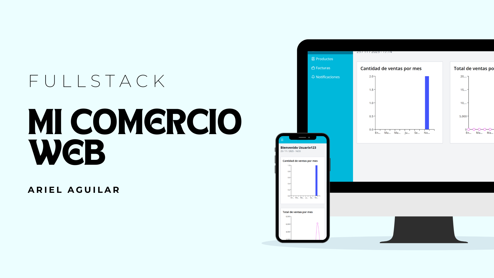
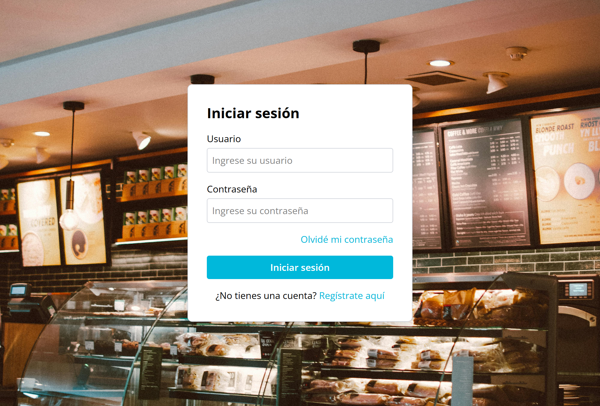
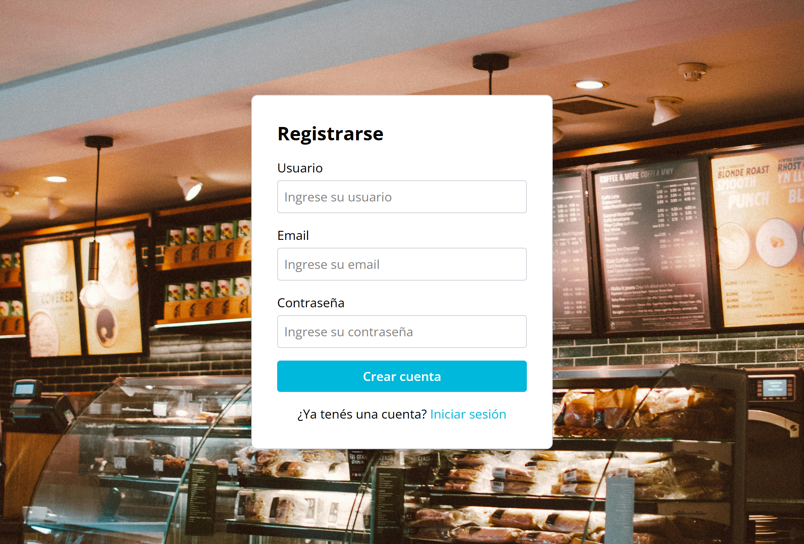
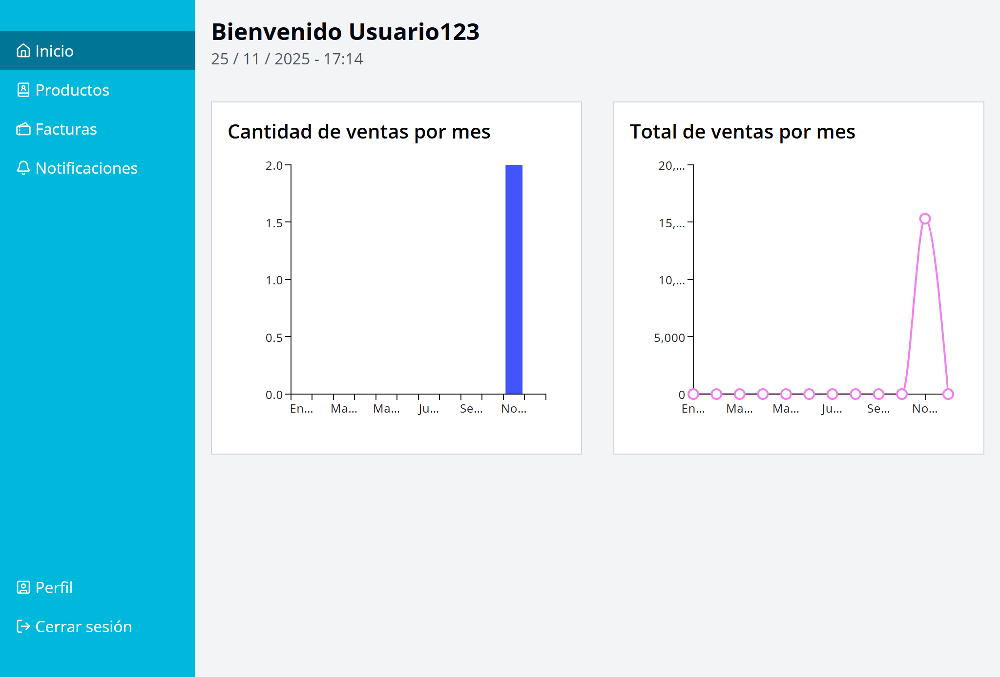
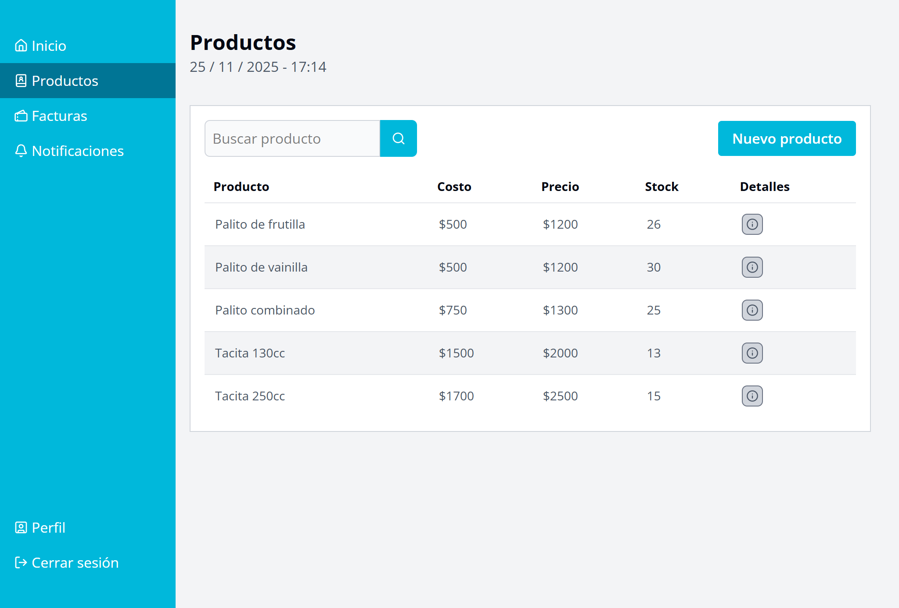
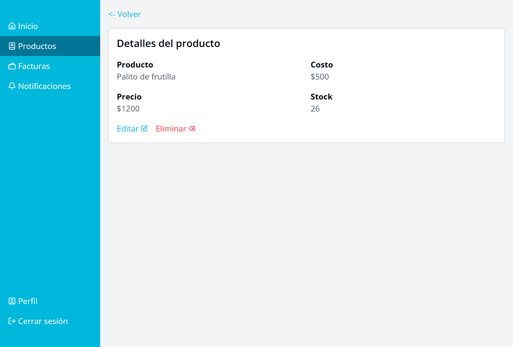
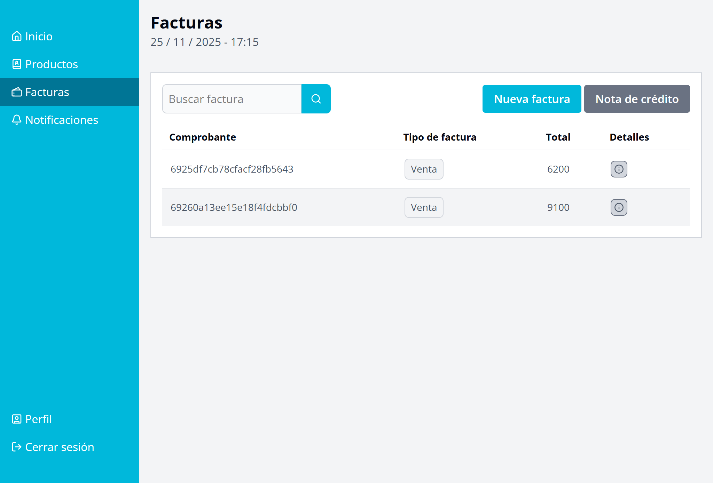
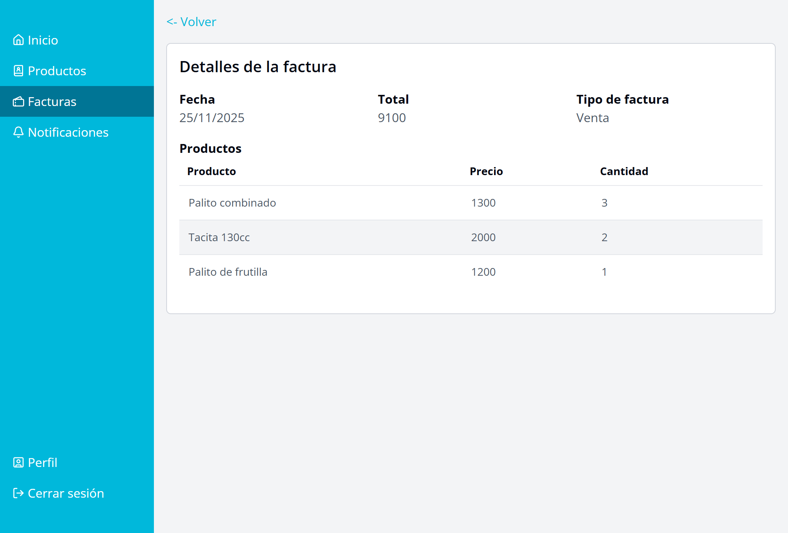
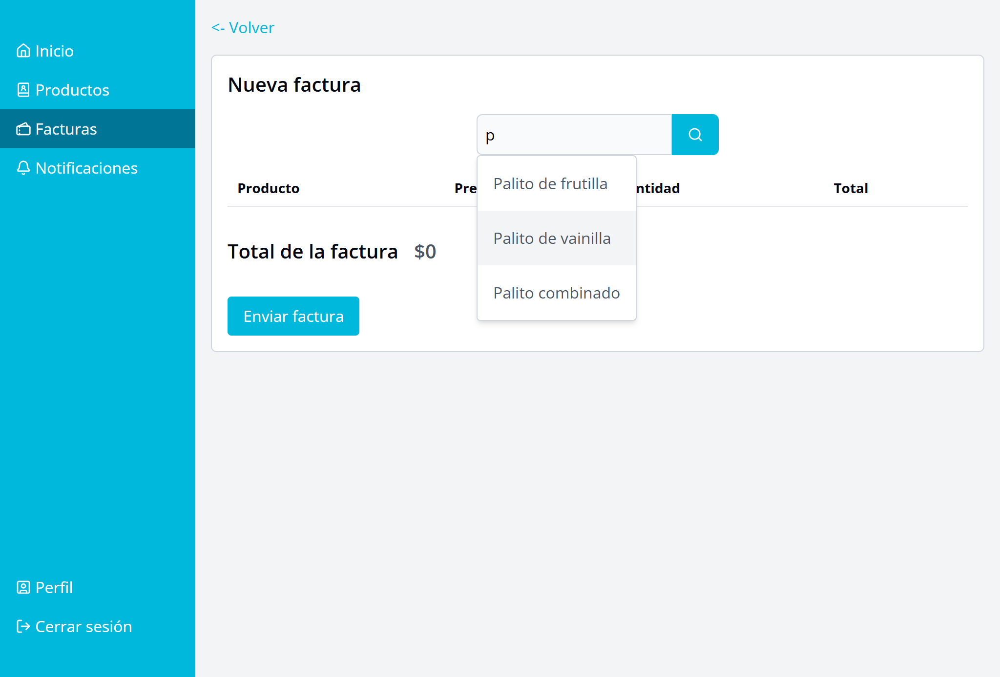
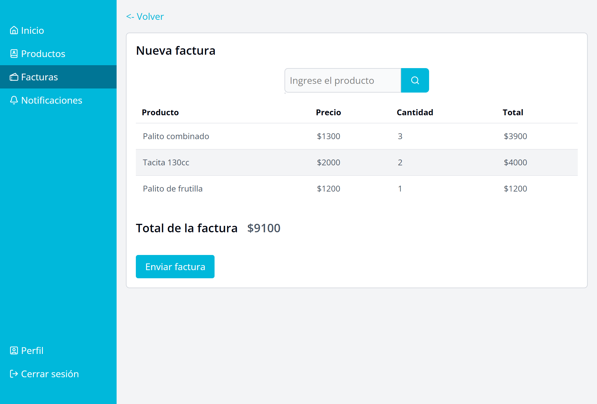

# Mi comercio web

[Link del proyecto](https://mi-comercio-web.vercel.app/)

## Descripción

Mi Comercio Web es una aplicación web diseñada para gestionar de manera integral una tienda, ofreciendo todas las herramientas necesarias para administrar productos, ventas y facturas desde un solo lugar. Permite cargar, editar y organizar inventario, registrar transacciones en tiempo real y acceder a un historial completo de ventas. Además, incluye funciones para controlar stock, generar reportes y obtener una visión detallada del rendimiento del negocio.

## Desafíos
El mayor desafío que enfrenté al realizar esta aplicación fue crear el resumen mensual de las ventas que se puede observar en el home, ya que debe analizar cada venta según su fecha, sumarlas y mostrarlas dentro de los charts.

## Soluciones

Utilicé la librería de MaterialUI para los charts y funciones en el backend que devuelvan la información necesaria para solucionar el desafío previamente mencionado.

## Tecnologías utilizadas
- MongoDB
- ExpressJS
- ReactJS
- NodeJS
- MaterialUI
- Zod
- JWT

## Resultados
El resultado final es una aplicación web funcional y fácil de usar que permite a los propietarios de tiendas gestionar sus operaciones diarias de manera eficiente. La interfaz intuitiva y las herramientas integradas facilitan la administración de productos, el seguimiento de ventas y la generación de informes, lo que contribuye al éxito del negocio.

## Imágenes

